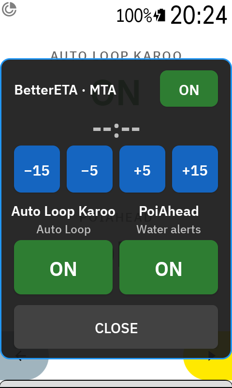
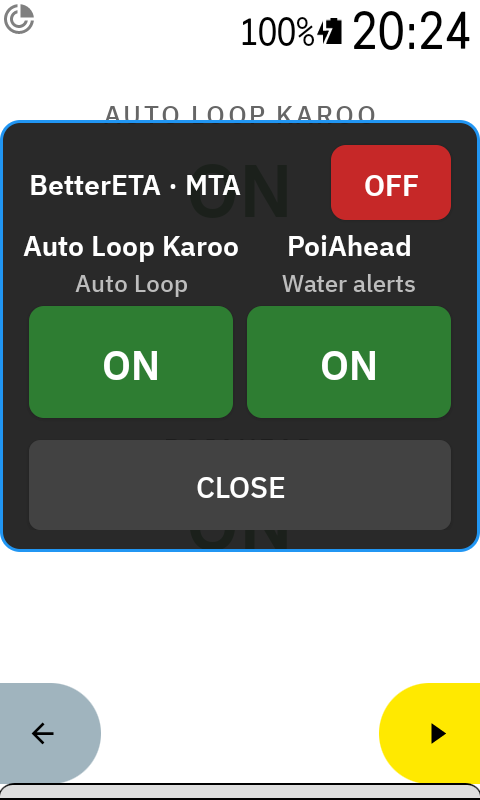

<picture>
  <source media="(prefers-color-scheme: dark)" srcset="https://gist.githubusercontent.com/anpaiss/78cf5eb76ad50594402b9778008a00a8/raw/AutoLoopKaroo-card-dark.svg">
  
</picture>
# Auto Loop Karoo

A [Hammerhead Karoo 3](https://www.hammerhead.io/karoo) extension that automatically scrolls through your ride data pages — so you can focus on riding.

---

## Screenshots

<table>
  <tr>
    <td></td>
    <td> </td>
  </tr>
</table>

<table>
  <tr>
    <td></td>
    <td>  </td>
  </tr>
</table>

## What's new in 1.2.1

- **Switches popup, second generation** (shared library 0.2.0): besides the ON/OFF buttons, the popup can host a time with its own switch, like BetterETA's mandatory arrival time (ON/OFF plus −15 / −5 / +5 / +15). Auto Loop's own switch is unchanged. See [Switches field](#switches-field) for the screenshots.
- **Fixes from the October code review**: the Switches field redraws as soon as Auto Loop is toggled from the app or from the bonus action, not only from the popup; the overlay permission is re-checked when the app comes back to the foreground; the configuration form no longer loses its state on a Compose recomposition; fields shared between threads are volatile; XML escaping of the generated manifest.

## Features

- **Auto-scroll** cycles through all pages in your active ride profile at a configurable interval.
- **Page Skipping**: Set a page duration to **0 seconds** to skip it during the loop. Skipped pages are passed with back-to-back presses, so they never show up on screen.
- **Starts automatically** when you begin recording a ride.
- **Stops automatically** when you pause or end the ride.
- **Navigation-aware**: Switches to the map page when approaching a turn, then resumes scrolling after the turn. Distances are fully configurable.
- **Toggle on/off** from the app settings or with the Karoo's **bottom-left hardware button** (the one the Karoo assigns to extension bonus actions, shared with pause), or from SRAM AXS buttons / ANT+ remotes bound to bonus actions.
- **Audible feedback** (beep + on-screen alert) when auto-scroll is toggled.
- **Switches data field** (1.2.0, popup extended in 1.2.1): a field for your ride pages that shows whether Auto Loop is ON or OFF. Tap it and a popup lets you switch Auto Loop, and the other extensions by the same author, on or off without leaving the ride screen.
- **Bottom-left button option**: choose whether the hardware button also pauses the loop or only marks a lap, as the Karoo does by itself.

---

## Requirements

- Hammerhead Karoo 3 (Hardware ID: k24)
- Karoo firmware with extension support

---

## Installation

1. Download the latest APK ([direct link](https://github.com/anpaiss/AutoLoopKaroo/releases/latest/download/AutoLoopKaroo.apk)) from [Releases](https://github.com/anpaiss/AutoLoopKaroo/releases)
2. Install via ADB:
   ```bash
   adb install AutoLoopKaroo.apk
   ```
   Or transfer the APK to the Karoo via USB and install with a file manager.

*Note: After installation, it is recommended to reboot the Karoo to ensure the extension service is fully registered.*

From 1.1.0 the app also ships a Karoo **extension manifest**, so it can be listed in the Karoo Extension Library and offer updates from there: the APK declares `https://github.com/anpaiss/AutoLoopKaroo/releases/latest/download/manifest.json` as `MANIFEST_URL`, and every release carries that file next to the APK.

### Publishing a release (maintainer notes)

1. Bump `versionCode` (must increase — it is what the Karoo compares to offer an update) and `versionName` in `app/build.gradle.kts`.
2. `./gradlew assembleRelease` with the release keystore in `local.properties` (`signing.*`). The build also writes `app/manifest.json` with the same version and code.
3. Create the GitHub release for tag `vX.Y.Z` (not a pre-release: `latest` only resolves to stable releases) and attach **both** files, the APK renamed to `AutoLoopKaroo.apk` and `manifest.json`, with exactly those names — both URLs are fixed.

---

## Configuration

Open the **Auto Loop Karoo** app on your Karoo:

| Setting | Description |
|---|---|
| **Auto Scroll** toggle | Enable or disable auto-scrolling globally. |
| **Time per page** | Seconds to display each page. Set to **Skip** (0s) to ignore a page in the loop. |
| **Sound Feedback** | Toggle audible beeps when enabling/disabling scroll. |
| **Switch-to-map distance** | Distance before a turn to switch to the map page (10–250 m). |
| **Resume distance** | Distance after a turn before auto-scroll resumes (10–250 m). |
| **Bottom-left button pauses the loop** | On (default): the button pauses and resumes the loop during a ride, as before. Off: the button only marks a lap and the loop is controlled from the app or the Switches field. |
| **Allow popup (overlay permission)** | Grants the permission the Switches popup needs to draw over the ride screen. The field says ALLOW OVERLAY until it is granted. |

Changes take effect immediately — no restart needed.

---

## Switches field

Add the **Switches** data field (under Auto Loop Karoo) to any ride page. It shows **AUTO LOOP KAROO** with ON or OFF underneath, and a tap opens a popup over the ride screen with one button per switch of every installed extension that supports it: **Auto Loop** here, **Water alerts** in [PoiAhead](https://github.com/anpaiss/PoiAhead), more as they come. Tap a button to flip the switch, CLOSE or wait 20 seconds to dismiss. Touches outside the popup still reach the ride screen.

The popup needs the overlay permission: open the app and press **Allow popup (overlay permission)** once. Each extension ships the same field through the shared [KarooSwitches](https://github.com/anpaiss/KarooSwitches) library, so whichever one you install first already gives you the popup, and the switches of the others appear as you install them. No extra APK is needed.

Since 1.2.1 a row can also be a **time with its own switch**, when an extension exposes one: BetterETA's mandatory arrival time shows its ON/OFF button and, while ON, the time with −15 / −5 / +5 / +15 buttons; OFF shrinks the row to its label. Auto Loop's row stays a plain ON/OFF button.

<table>
  <tr>
    <td></td>
    <td></td>
  </tr>
  <tr>
    <td>Time row <b>ON</b></td>
    <td>Time row <b>OFF</b></td>
  </tr>
</table>

---

## How It Works

```
Ride starts (Recording)
    └─ Auto-scroll enabled? ──Yes──► Start cycling pages based on per-page dwell time
                             │       (Skips pages set to 0s)
                             No ──► Wait (toggle from app or bottom-left button)

Approaching turn (within switch-to-map distance, default 25 m)
    └─► Switch to map page automatically

Past the turn by resume distance (default 10 m)
    └─► Resume page scrolling

Ride paused or ended
    └─► Stop scrolling
```

---

## Development Notes

- **Target SDK 31**: Aligned with Karoo 3 (Android 12) for maximum stability and input handling.
- **Extension ID**: `autoloopkaroo` (No dots, as required by Hammerhead SDK).
- **Bonus Action** `toggle_scroll`: the Karoo fires it from the bottom-left hardware button during a ride, or from SRAM AXS buttons / external ANT+ controllers bound to bonus actions. It is not in the Control Center.
- **Switches**: the field, the popup and the switch protocol come from the [KarooSwitches](https://github.com/anpaiss/KarooSwitches) library. The switch itself is `AutoLoopSwitch`, an exported receiver behind a signature-level permission, so only extensions signed with the same key can see or flip it.

---

## License

MIT License — see [LICENSE](LICENSE) for details.


